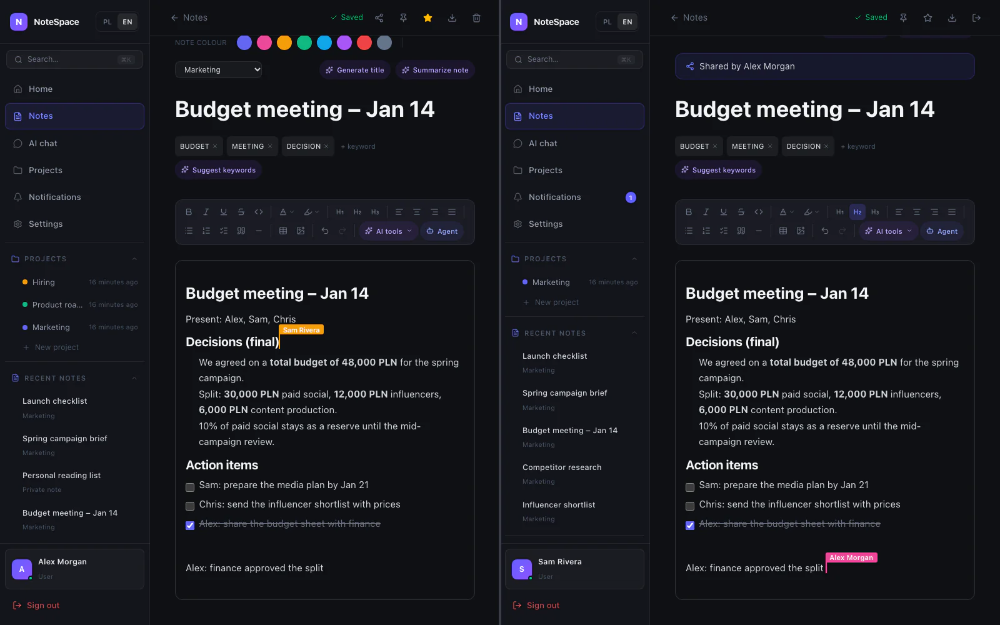
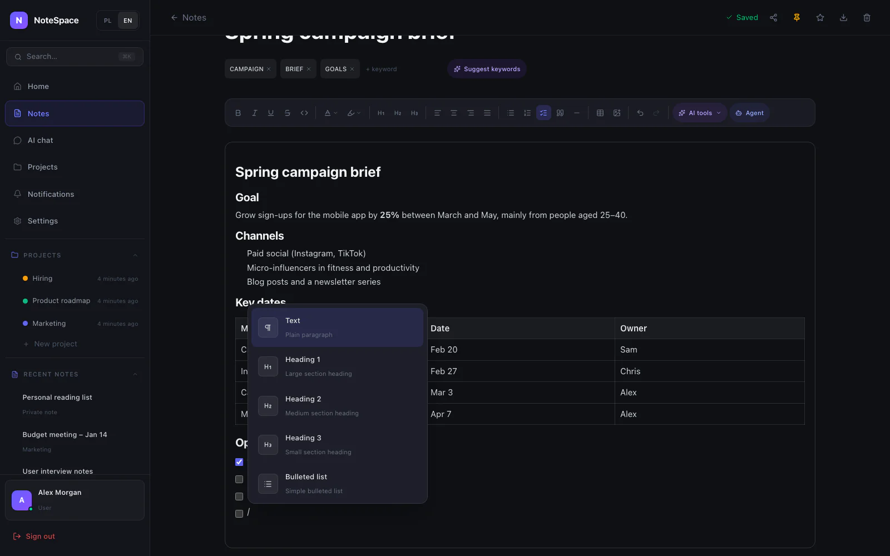
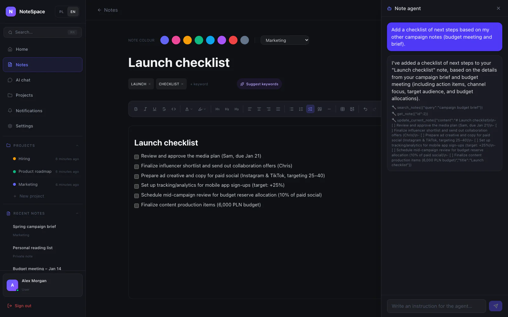
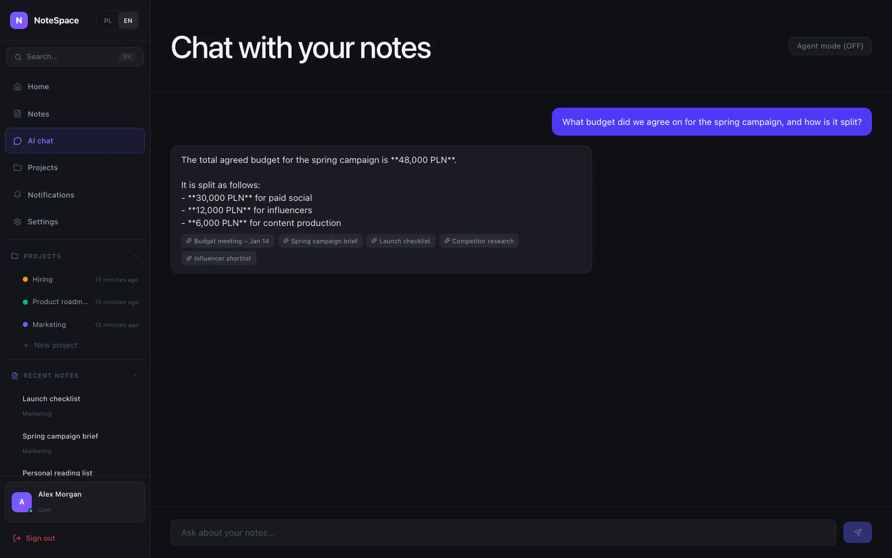
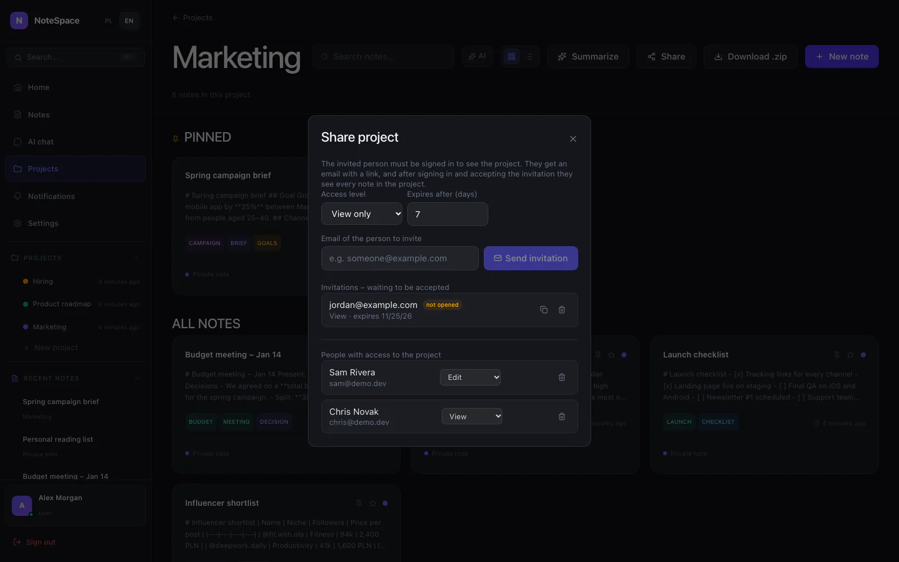
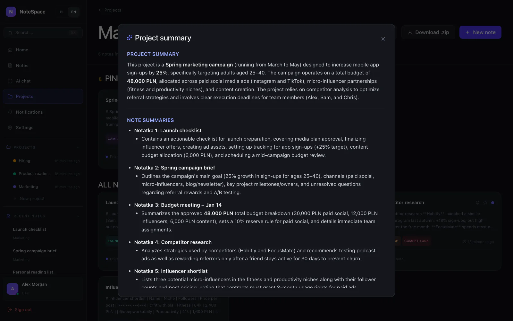
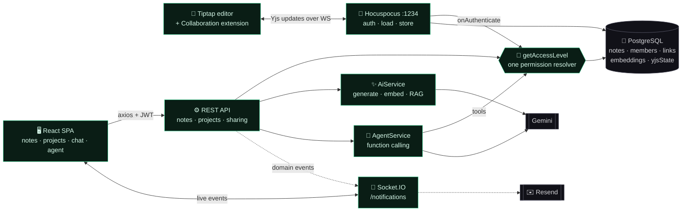
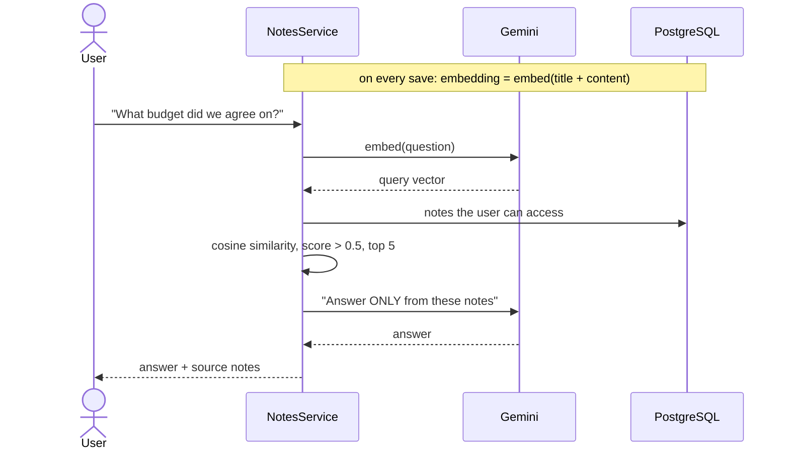

<p align="center">
  
</p>

<p align="center">
  
  
  
  
  
  
  
  
  
  
</p>

<p align="center">
  <a href="#-highlights">Highlights</a> ·
  <a href="#-screenshots">Screenshots</a> ·
  <a href="#-architecture">Architecture</a> ·
  <a href="#-quick-start">Quick start</a> ·
  <a href="portfolio/PORTFOLIO.en.md">Full case study</a>
</p>

---

> **Your notes, edited together and answered by AI.** A rich Tiptap editor with **conflict-free real-time co-editing** (Yjs + Hocuspocus), granular sharing with expiring links, live notifications, and an AI layer on Gemini: writing helpers, **semantic search**, **"chat with your notes" (RAG)** with sources, and an **agent** that searches, reads, creates and updates notes.

<p align="center">
  
</p>

## ✨ Highlights

<table>
  <tr>
    <td width="50%" valign="top">
      <h3>👥 Real-time co-editing</h3>
      A Yjs document per note, synced through Hocuspocus, with named cursors. <b>VIEW-only users get a read-only connection</b>: they see changes live, and the server rejects their updates.
    </td>
    <td width="50%" valign="top">
      <h3>🔑 Granular sharing</h3>
      <code>VIEW &lt; EDIT &lt; DELETE</code> on notes and projects, with project access inherited by its notes. Share links can be locked to an email address, expire and be revoked. Invites have accept/decline.
    </td>
  </tr>
  <tr>
    <td width="50%" valign="top">
      <h3>💬 Chat with your notes (RAG)</h3>
      The question is embedded, and the top 5 notes by cosine similarity go into the prompt. The model answers <b>only from your notes</b> and returns clickable sources.
    </td>
    <td width="50%" valign="top">
      <h3>🤖 Tool-using agent</h3>
      A Gemini function-calling loop with <code>search_notes</code>, <code>get_note</code>, <code>create_note</code>, <code>list_projects</code> and <code>update_current_note</code>. Every tool step is visible in the UI.
    </td>
  </tr>
  <tr>
    <td width="50%" valign="top">
      <h3>✍️ AI writing helpers</h3>
      Generate, continue from the cursor, rewrite a selection, suggest a title and keywords, and summarize a note or a whole project.
    </td>
    <td width="50%" valign="top">
      <h3>🔔 Live notifications</h3>
      Socket.IO room per user for shares, revocations, claimed links and invites, decoupled through domain events. Emails go out through Resend.
    </td>
  </tr>
</table>

## 📸 Screenshots

<table>
  <tr>
    <td width="50%"></td>
    <td width="50%"></td>
  </tr>
  <tr>
    <td align="center"><sub><b>Editor</b> with slash commands, toolbar and AI actions</sub></td>
    <td align="center"><sub><b>AI agent</b> searching, reading and updating notes</sub></td>
  </tr>
  <tr>
    <td width="50%"></td>
    <td width="50%"></td>
  </tr>
  <tr>
    <td align="center"><sub><b>Chat with your notes</b>: answer with source notes</sub></td>
    <td align="center"><sub><b>Sharing</b>: members, access levels, expiring links</sub></td>
  </tr>
  <tr>
    <td colspan="2"></td>
  </tr>
  <tr>
    <td colspan="2" align="center"><sub><b>Projects</b>, pinned and favourite notes, and an AI project summary</sub></td>
  </tr>
</table>

## 🏗️ Architecture



Three channels, each fit for its job: **REST** for CRUD and AI, a **Hocuspocus WebSocket** for document sync and **Socket.IO** for notifications. Permissions are computed in **one place** and reused by REST, the agent's tools and the collaboration server.

<details>
<summary><b>🔄 How "chat with your notes" works</b></summary>



</details>

## 🧰 Tech stack

| | |
|---|---|
| **Frontend** | React 19 · Vite · Tiptap 3 · Yjs + Hocuspocus provider · TanStack Query · MUI · Tailwind CSS v4 · Zod |
| **Backend** | NestJS 11 · TypeORM · Socket.IO · Hocuspocus server · EventEmitter · nestjs-i18n · Swagger |
| **Data** | PostgreSQL: `jsonb` embeddings, `bytea` Yjs state, per-user pin and favourite preferences |
| **AI** | Google Gemini: text generation, function calling, embeddings |
| **Infra** | Resend (email) · local image uploads |
| **Quality** | Jest · class-validator DTOs · ESLint · Prettier · `*.http` request files |

## 🚀 Quick start

Requirements: **Node.js**, **PostgreSQL**, a **Gemini API key** and, optionally, a **Resend API key**.

```bash
# backend → http://localhost:3001  (Swagger: /api/docs, Hocuspocus on :1234)
cd backend
cp .env.example .env      # PORT, YJS_PORT, DB_*, JWT_SECRET, GEMINI_*, RESEND_API_KEY, FRONTEND_URL
npm install
npm run migration:run
npm run start:dev

# frontend → http://localhost:3000
cd ../frontend
npm install
npm run dev
```

## 📁 Project structure

```text
ai-notes/
├── backend/            NestJS API + Hocuspocus server
│   └── src/
│       ├── notes/  projects/   CRUD, sharing, share links, search, RAG
│       ├── ai/                 writing helpers, embeddings
│       ├── agent/              function-calling loop and tools
│       ├── yjs/                collaboration server (auth, load, store)
│       ├── notifications/      events → Socket.IO + email
│       └── uploads/  mail/  users/
├── frontend/           React + Vite SPA
└── portfolio/          case study (EN/PL) and screenshots
```

## 🗺️ Roadmap

- [ ] pgvector + ANN index instead of in-memory similarity
- [ ] Version history from Yjs snapshots, comments
- [ ] Offline mode with IndexedDB persistence
- [ ] Streaming AI responses

## 📖 Read more

The full case study covers the problem, the data model, the API, an example run step by step, key decisions and trade-offs, and what I learned: **[English](portfolio/PORTFOLIO.en.md)** · **[Polski](portfolio/PORTFOLIO.pl.md)**.

---

<p align="center">
  <sub>Built by <a href="https://github.com/MaksZiem"><b>Maksymilian Ziembicki</b></a> · Full-stack developer</sub>
</p>
