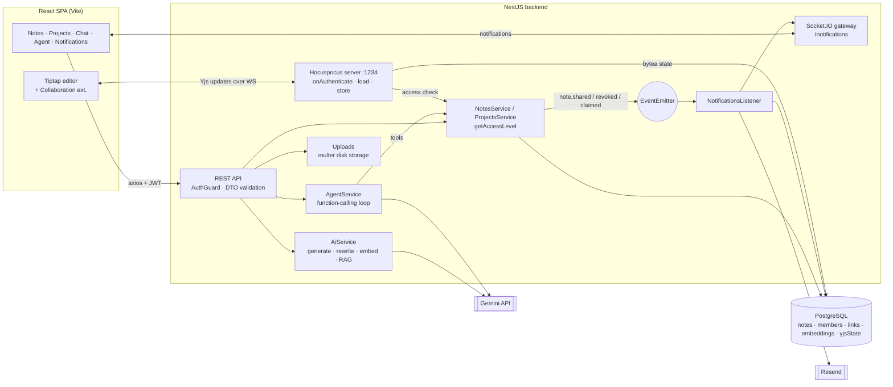
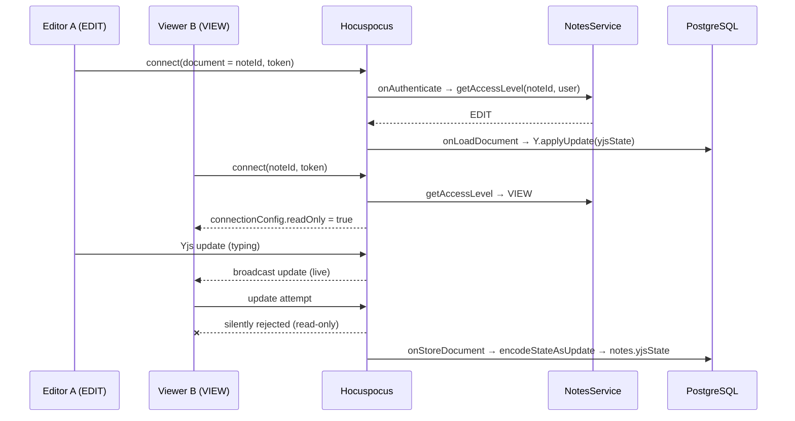
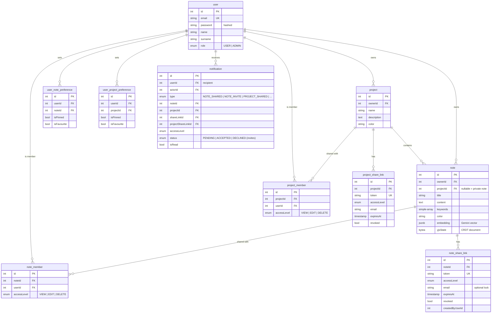

# AI Notes

## Overview

AI Notes is a full-stack notes app in the spirit of Notion. Notes live privately or inside **projects**, are edited in a rich **Tiptap** editor (slash commands, tables, task lists, images, colors), and can be **co-edited in real time** by several people thanks to **Yjs CRDTs** synced through a **Hocuspocus** server. Notes and projects can be shared with users at `VIEW` / `EDIT` / `DELETE` level or through expiring, revocable **share links**. Invitations arrive as live notifications and by email.

On top of that sits an AI layer built on **Google Gemini**:
- **writing helpers in the editor:** generate, continue, rewrite, title and keywords,
- **semantic search** over note embeddings,
- **"Chat with your notes" (RAG):** answers grounded in the most relevant notes, with sources,
- **an AI agent** that can search, read, create and update notes through function calling,
- **project summaries** across all notes in a project.

## Problem

Personal knowledge gets scattered across many notes, and finding an answer means remembering *where* you wrote it. Keyword search fails when you don't remember the exact words. Collaborating on notes usually means either overwriting each other or giving up control over who can do what.

AI Notes addresses this with:
- **meaning-based search** and **question answering grounded in your own notes**, not in the model's general knowledge,
- **conflict-free real-time editing** (CRDT), where read-only users still watch changes live,
- a **granular permission model** for notes and projects, with invite links that can expire, be restricted to an email address, or be revoked,
- an **agent** that does the repetitive work (*"find my notes about X and create a summary note in project Y"*).

## Key features

- **Notes & projects:** CRUD, colors, keywords, pin and favourite (stored per user), move a note between projects, recent projects.
- **Rich editor (Tiptap 3):** headings, lists, task lists, quotes, code blocks, tables, links, images (upload), text color and highlight, alignment, Markdown support, and a **slash menu** (`/`).
- **Real-time collaboration:** Yjs document per note served by Hocuspocus, with collaboration cursors. **VIEW-only users get a read-only connection**: they receive live updates, but their changes are rejected server-side.
- **Sharing & permissions:** additive access levels `VIEW < EDIT < DELETE` on notes and projects. Project access is inherited by its notes, and direct note membership is the fallback. Admins have full access.
- **Share links:** tokenized links with an access level, an optional email lock, optional expiry and revocation. Claiming a link grants membership.
- **Notifications:** live via Socket.IO (`/notifications` namespace, room per user) for shares, revocations, claimed links and **invites with accept/decline**. Emails are sent through **Resend**.
- **AI writing:** generate a note from a prompt, continue from the cursor, rewrite a selection, suggest a title, suggest keywords, summarize a note or a whole project.
- **Semantic search:** each note's title and content are embedded on save; queries are embedded and ranked by cosine similarity (threshold 0.5, top 15). Includes a re-index endpoint.
- **RAG chat:** the top 5 semantically relevant notes go into the prompt, and the model answers **only** from them, returning the source notes.
- **AI agent:** a Gemini function-calling loop (max 6 turns) with tools `search_notes`, `get_note`, `create_note`, `list_projects`, plus `update_current_note` when opened from the editor. The UI shows every tool step.
- **Export:** download a note as Markdown, or a set of notes as a ZIP of `.md` files.
- **Admin panel** and **i18n** for API messages (PL/EN).

## Tech stack

| Layer | Technology | Why |
|---|---|---|
| Frontend | React 19 + Vite + TypeScript | Fast SPA dev loop; the editor is highly interactive |
| Editor | Tiptap 3 (ProseMirror) | Extensible rich-text editor with first-class Yjs collaboration |
| Collaboration | Yjs + Hocuspocus (server & provider) | CRDTs merge concurrent edits without conflicts; Hocuspocus adds auth hooks and persistence |
| Data fetching | TanStack Query + axios | Caching, invalidation, optimistic UI for lists and preferences |
| UI | MUI + Tailwind v4 + lucide | Ready-made dialogs and menus plus utility styling |
| Backend | NestJS 11 + Swagger | Modules for notes, projects, AI, agent, notifications, uploads, Yjs |
| DB | PostgreSQL + TypeORM | Relations for membership and sharing; `jsonb` embeddings; `bytea` Yjs state |
| Realtime | Socket.IO (notifications) + Hocuspocus WS (documents) | Each transport fits its job: events vs CRDT sync |
| Events | `@nestjs/event-emitter` | Domain events (shared, revoked, claimed) decoupled from notification delivery |
| AI | Gemini (`@google/genai`) | Text generation, function calling for the agent, embeddings for search |
| Email | Resend | Share and invite emails |

## Architecture



The app uses three separate channels: **REST** for CRUD and AI, **Hocuspocus WebSocket** for document sync, and **Socket.IO** for notifications. Permissions are computed in one place (`getAccessLevel`) and reused by REST, the agent's tools and the Yjs `onAuthenticate` hook.

## Data flow: chat with your notes (RAG)

```mermaid
sequenceDiagram
  actor U as User
  participant FE as React
  participant API as NotesController
  participant NS as NotesService
  participant AI as AiService
  participant G as Gemini
  participant DB as PostgreSQL

  Note over NS,DB: On every note create/update:<br/>embedding = embed(title + content) → notes.embedding (jsonb)
  U->>FE: "What did we decide about the onboarding flow?"
  FE->>API: POST /notes/chat {question}
  API->>NS: ragChat(question, user)
  NS->>AI: embedText(question)
  AI->>G: embedContent (gemini-embedding)
  G-->>AI: query vector
  NS->>DB: all notes the user can access
  NS->>NS: cosine similarity, score > 0.5, top 5
  NS->>AI: answerFromContext(question, top notes)
  AI->>G: "Answer ONLY from these notes; say so if absent"
  G-->>AI: answer
  NS-->>FE: {answer, sources: [{id, title}]}
  FE-->>U: answer + clickable source notes
```

## Data flow: real-time co-editing



## Database schema



Pin and favourite are **per-user preferences**, not note fields, so a shared note can be pinned by one member and not by another.

## API highlights

| Method | Route | Purpose |
|---|---|---|
| `POST` | `/auth/signup`, `/auth/signin` | Auth |
| `GET/POST/PATCH/DELETE` | `/notes`, `/notes/:id` | Private notes CRUD |
| `GET/POST/PATCH/DELETE` | `/projects/:projectId/notes/:id` | Notes inside a project |
| `PATCH` | `/notes/:id/move` | Move a note to another project |
| `POST/DELETE` | `/notes/:id/members`, `/projects/:id/members` | Grant or revoke access |
| `POST` | `/notes/:id/share-links`, `/projects/:id/share-links` | Create a share link |
| `GET/PATCH` | `/shared/:token` | Open or edit through a share link |
| `POST` | `/shared/:token/claim`, `/project-invites/:token/claim` | Turn a link into membership |
| `GET` | `/notes/search?q=…` | Semantic search |
| `POST` | `/notes/chat` | RAG chat |
| `POST` | `/agent/chat` | AI agent with tools |
| `POST` | `/ai/generate` · `/continue` · `/rewrite` · `/title` · `/keywords` | Editor AI helpers |
| `POST` | `/ai/projects/:projectId/summary` | Project summary |
| `POST` | `/notifications/:id/accept` · `/decline` | Respond to an invite |
| `POST` | `/uploads/image` | Image upload for the editor |

**Example: agent request**

```http
POST /agent/chat
Authorization: Bearer <jwt>

{ "message": "Find my notes about the marketing campaign and create a summary note in the Marketing project",
  "context": { "noteId": 42 } }
```

```json
{
  "answer": "I created the note \"Marketing campaign – summary\" in the Marketing project, based on 3 notes.",
  "steps": [
    { "tool": "search_notes",  "args": { "query": "marketing campaign" }, "result": [ { "id": 12, "title": "Q3 campaign ideas" }, "…" ] },
    { "tool": "list_projects", "args": {}, "result": [ { "id": 3, "name": "Marketing" } ] },
    { "tool": "create_note",   "args": { "title": "Marketing campaign – summary", "content": "…", "projectId": 3 }, "result": { "id": 57 } }
  ]
}
```

<!-- TODO: replace with a real agent response -->

## Example run

1. **User A** creates the project *Marketing* and writes notes in the editor, using `/` for headings, task lists and a table, plus an uploaded image. *(screenshot: editor.png)*
2. A selects a paragraph and clicks **Rewrite → more formal**, then **Suggest title** and **Suggest keywords**.
3. A shares the project with **user B** at `EDIT`, and with **user C** through a link that is locked to C's email, set to `VIEW` and expires in 7 days. B and C get a live notification plus an email; C accepts the invite. *(screenshot: share.png)*
4. A and B open the same note and type at the same time; their named cursors move live. C watches the changes but can't edit. *(screenshot: collab.png)*
5. In **Chat with notes**, A asks *"What budget did we agree on?"* and gets an answer with links to the 2 source notes. *(screenshot: rag-chat.png)*
6. In the **agent panel** inside a note, A asks *"Add a checklist of next steps based on my other campaign notes."* The agent runs `search_notes` → `get_note` ×2 → `update_current_note`, and each step is visible. *(screenshot: agent.png)*
7. A clicks **Summarize project** for an AI overview of all notes, then **downloads** the project as a ZIP of Markdown files. *(screenshot: projects.png)*

## Key decisions & trade-offs

- **CRDT (Yjs) instead of locking or last-write-wins.** True concurrent editing without conflicts. Document state is stored as binary `bytea` next to the plain `content` used for search, AI and export, which means two representations to keep in sync.
- **Read-only enforced on the server.** The Hocuspocus connection is flagged `readOnly` for VIEW users, so the server drops their updates no matter what the client does.
- **Embeddings in Postgres `jsonb` + cosine similarity in Node.** No extra infrastructure, fine for a personal or team scale. The next step would be **pgvector** with an index.
- **Grounded RAG with sources.** The prompt forbids answering beyond the provided notes and the response returns sources, so the user can verify the answer.
- **Agent with a small, scoped tool set.** Every tool goes through the same permission-checked services as the REST API, and the loop is capped at 6 turns. The system prompt tells the model to avoid unnecessary calls, because the API is rate-limited.
- **Events for notifications.** Sharing logic emits domain events, and a listener persists the notification, pushes it over Socket.IO and sends the email, which keeps the sharing services free of delivery concerns.

## Challenges & solutions

- **Permissions in three places (REST, agent, WebSocket).** All three go through one `getAccessLevel(note, user)`: admin or owner → `DELETE`, then project membership, then note membership, otherwise 403. Hocuspocus calls it in `onAuthenticate`.
- **Gemini function calling across turns.** Rebuilding the model message from `functionCalls` dropped the `thoughtSignature` and caused HTTP 400. The fix was to push the **raw candidate content** back into the history.
- **Invite flows that are actually safe.** Share links use unique tokens, can be locked to an email address, and can expire or be revoked. Claiming one creates a membership and notifies the owner; invites have an explicit accept/decline state.
- **Avoiding request spam while typing.** Debounced saves and AI calls on the frontend (`useDebounce`, `useDebouncedCallback`), plus live updates over WebSockets instead of polling.

## Testing & quality

- Jest unit tests for the notes, projects and users services and controllers.
- DTO validation with class-validator; Swagger docs; ESLint + Prettier on both apps.
- Example requests in `*.http` files.
- <!-- TODO: add e2e tests for sharing + permissions and CI -->

## Security

- JWT auth guard and an admin guard; passwords are hashed and excluded from serialization.
- One central permission resolver used by REST, the agent's tools and the collaboration server.
- Share links: random tokens, optional email lock, expiry and revocation.
- Image uploads: file type filter and size limit.
- AI answers are limited to notes the user is allowed to access, because semantic search runs only over those notes.

## Running locally

Requirements: Node.js, PostgreSQL, a Gemini API key and (optionally) a Resend API key.

```bash
cd ai-notes-backend
# .env: DB_HOST, DB_PORT, DB_USER, DB_PASS, DB_NAME, JWT_SECRET,
#       GEMINI_API_KEY, GEMINI_MODEL, RESEND_API_KEY, FRONTEND_URL
npm install
npm run start:dev          # REST + Socket.IO, Hocuspocus on :1234

cd ../ai-notes-frontend
npm install
npm run dev                # http://localhost:5173
```

<!-- TODO: add .env.example files to the repo -->

## Limitations & roadmap

- Semantic search loads the user's notes into memory. Next step: pgvector + an ANN index.
- `synchronize: true` instead of migrations; CORS origin is hard-coded for local development.
- Ideas: version history from Yjs snapshots, comments, offline mode with IndexedDB persistence, streaming AI responses.

## What I learned

- How **CRDTs** work in practice: Yjs documents, update encoding, persistence and server-side read-only enforcement.
- Building **RAG from scratch**: embeddings, similarity ranking, grounding prompts and returning sources.
- Implementing an **LLM agent loop** with function calling, tool results and thought signatures.
- Designing **sharing and permissions** (inherited plus direct access, tokens, invites) and applying them consistently across REST and WebSockets.
- Running **multiple realtime channels** (CRDT sync and notifications) side by side.
