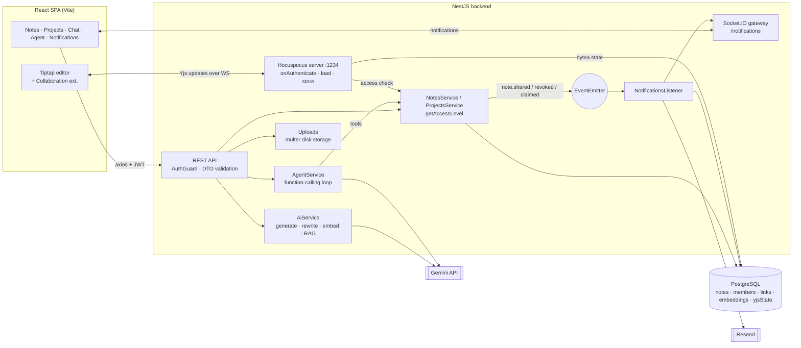
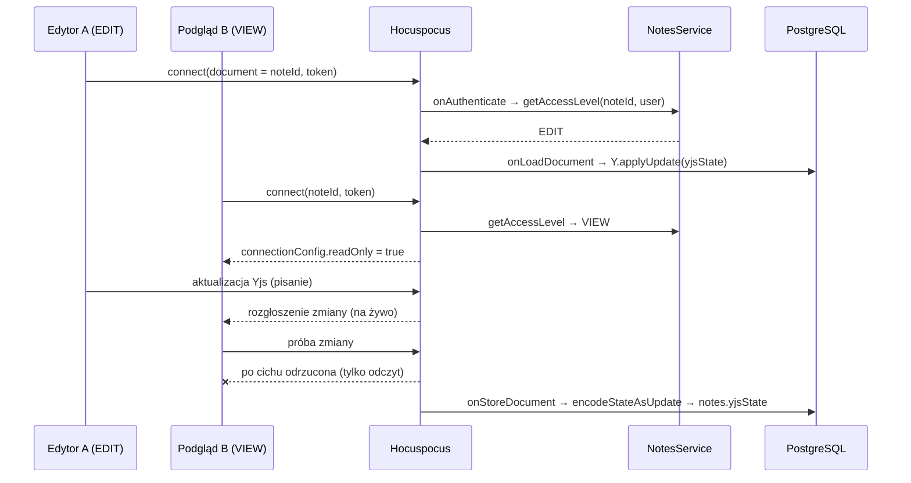
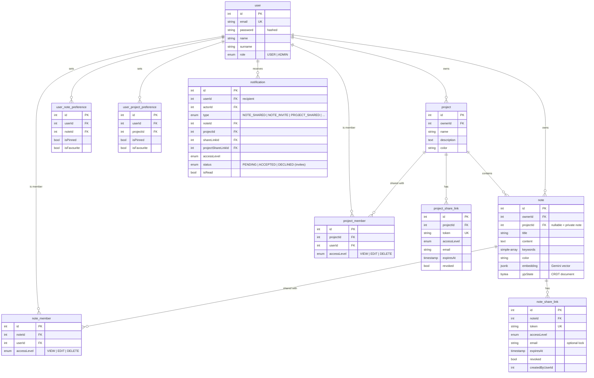

# AI Notes

## Opis

AI Notes to aplikacja full-stack do notatek w duchu Notion. Notatki są prywatne albo należą do **projektów**, edytuje się je w rozbudowanym edytorze **Tiptap** (komendy „/”, tabele, listy zadań, obrazy, kolory), a kilka osób może je **edytować jednocześnie w czasie rzeczywistym** dzięki **CRDT Yjs** synchronizowanym przez serwer **Hocuspocus**. Notatki i projekty można udostępniać użytkownikom na poziomie `VIEW` / `EDIT` / `DELETE` albo przez wygasające, odwoływalne **linki**. Zaproszenia przychodzą jako powiadomienia na żywo i mailem.

Na tym działa warstwa AI oparta na **Google Gemini**:
- **pomoc w pisaniu w edytorze:** generowanie, kontynuacja, przeredagowanie, tytuł i słowa kluczowe,
- **wyszukiwanie semantyczne** po embeddingach notatek,
- **„Czat z notatkami” (RAG):** odpowiedzi oparte na najtrafniejszych notatkach, ze źródłami,
- **agent AI**, który przez function calling wyszukuje, czyta, tworzy i aktualizuje notatki,
- **podsumowania projektów** obejmujące wszystkie notatki w projekcie.

## Problem

Wiedza rozprasza się po wielu notatkach, a znalezienie odpowiedzi wymaga pamiętania, *gdzie* się ją zapisało. Wyszukiwanie po słowach kluczowych zawodzi, gdy nie pamiętasz dokładnych sformułowań. Współpraca nad notatkami zwykle oznacza albo nadpisywanie się nawzajem, albo brak kontroli nad tym, kto co może.

AI Notes odpowiada na to przez:
- **wyszukiwanie po znaczeniu** i **odpowiedzi oparte na Twoich własnych notatkach**, a nie na ogólnej wiedzy modelu,
- **bezkonfliktową edycję na żywo** (CRDT), przy której użytkownicy z samym podglądem też widzą zmiany na bieżąco,
- **precyzyjny model uprawnień** dla notatek i projektów, z linkami-zaproszeniami, które mogą wygasać, być przypisane do adresu e-mail albo zostać odwołane,
- **agenta**, który wykonuje powtarzalną pracę (*„znajdź moje notatki o X i utwórz notatkę z podsumowaniem w projekcie Y”*).

## Kluczowe funkcje

- **Notatki i projekty:** CRUD, kolory, słowa kluczowe, przypinanie i ulubione (zapisywane per użytkownik), przenoszenie notatek między projektami, ostatnie projekty.
- **Edytor rich-text (Tiptap 3):** nagłówki, listy, listy zadań, cytaty, bloki kodu, tabele, linki, obrazy (upload), kolor tekstu i wyróżnienie, wyrównanie, obsługa Markdown i **menu „/”**.
- **Współpraca na żywo:** dokument Yjs dla każdej notatki serwowany przez Hocuspocus, z kursorami współpracowników. **Użytkownicy z samym VIEW dostają połączenie tylko do odczytu**: widzą zmiany na żywo, ale serwer odrzuca ich edycje.
- **Udostępnianie i uprawnienia:** addytywne poziomy `VIEW < EDIT < DELETE` dla notatek i projektów. Notatki dziedziczą dostęp z projektu, a bezpośrednie członkostwo w notatce działa jako uzupełnienie. Admin ma pełny dostęp.
- **Linki udostępniania:** linki z tokenem, poziomem dostępu, opcjonalnym przypisaniem do e-maila, opcjonalnym terminem ważności i możliwością odwołania. Użycie linku nadaje członkostwo.
- **Powiadomienia:** na żywo przez Socket.IO (namespace `/notifications`, pokój per użytkownik) o udostępnieniach, odebraniu dostępu, użyciu linku i **zaproszeniach z akceptacją lub odrzuceniem**. Maile wysyła **Resend**.
- **Pisanie z AI:** generowanie notatki z promptu, kontynuacja od kursora, przeredagowanie zaznaczenia, propozycja tytułu i słów kluczowych, podsumowanie notatki albo całego projektu.
- **Wyszukiwanie semantyczne:** tytuł i treść każdej notatki są zamieniane na embedding przy zapisie; zapytanie też jest embeddowane, a wyniki są sortowane po podobieństwie cosinusowym (próg 0.5, top 15). Jest też endpoint do reindeksacji.
- **Czat RAG:** 5 najtrafniejszych notatek trafia do promptu, a model odpowiada **wyłącznie** na ich podstawie i zwraca notatki źródłowe.
- **Agent AI:** pętla function calling w Gemini (maksymalnie 6 tur) z narzędziami `search_notes`, `get_note`, `create_note`, `list_projects` oraz `update_current_note`, gdy agent jest otwarty z edytora. UI pokazuje każdy krok.
- **Eksport:** pobranie notatki jako Markdown albo zestawu notatek jako ZIP z plikami `.md`.
- **Panel admina** i **i18n** komunikatów API (PL/EN).

## Stack technologiczny

| Warstwa | Technologia | Dlaczego |
|---|---|---|
| Frontend | React 19 + Vite + TypeScript | Szybki cykl pracy nad SPA; edytor jest mocno interaktywny |
| Edytor | Tiptap 3 (ProseMirror) | Rozszerzalny edytor rich-text z pierwszorzędnym wsparciem dla Yjs |
| Współpraca | Yjs + Hocuspocus (serwer i provider) | CRDT scalają równoległe edycje bez konfliktów; Hocuspocus dokłada hooki autoryzacji i zapisu |
| Pobieranie danych | TanStack Query + axios | Cache, unieważnianie, optymistyczne UI dla list i preferencji |
| UI | MUI + Tailwind v4 + lucide | Gotowe dialogi i menu plus stylowanie klasami narzędziowymi |
| Backend | NestJS 11 + Swagger | Moduły: notatki, projekty, AI, agent, powiadomienia, uploady, Yjs |
| Baza | PostgreSQL + TypeORM | Relacje dla członkostw i udostępnień; embeddingi w `jsonb`; stan Yjs w `bytea` |
| Realtime | Socket.IO (powiadomienia) + WS Hocuspocus (dokumenty) | Każdy transport pasuje do swojego zadania: zdarzenia vs synchronizacja CRDT |
| Zdarzenia | `@nestjs/event-emitter` | Zdarzenia domenowe (udostępniono, odebrano, użyto linku) oddzielone od doręczania powiadomień |
| AI | Gemini (`@google/genai`) | Generowanie tekstu, function calling dla agenta, embeddingi do wyszukiwania |
| E-mail | Resend | Maile o udostępnieniach i zaproszeniach |

## Architektura



Aplikacja korzysta z trzech oddzielnych kanałów: **REST** dla CRUD i AI, **WebSocket Hocuspocus** dla synchronizacji dokumentów i **Socket.IO** dla powiadomień. Uprawnienia liczy jedno miejsce (`getAccessLevel`), z którego korzystają REST, narzędzia agenta i hook `onAuthenticate` w Yjs.

## Przepływ danych: czat z notatkami (RAG)

```mermaid
sequenceDiagram
  actor U as Użytkownik
  participant FE as React
  participant API as NotesController
  participant NS as NotesService
  participant AI as AiService
  participant G as Gemini
  participant DB as PostgreSQL

  Note over NS,DB: Przy każdym utworzeniu/edycji notatki:<br/>embedding = embed(tytuł + treść) → notes.embedding (jsonb)
  U->>FE: "Co ustaliliśmy w sprawie onboardingu?"
  FE->>API: POST /notes/chat {question}
  API->>NS: ragChat(question, user)
  NS->>AI: embedText(question)
  AI->>G: embedContent (gemini-embedding)
  G-->>AI: wektor zapytania
  NS->>DB: wszystkie notatki dostępne dla użytkownika
  NS->>NS: podobieństwo cosinusowe, score > 0.5, top 5
  NS->>AI: answerFromContext(question, top notatki)
  AI->>G: "Odpowiadaj WYŁĄCZNIE na podstawie notatek; powiedz, jeśli brak"
  G-->>AI: odpowiedź
  NS-->>FE: {answer, sources: [{id, title}]}
  FE-->>U: odpowiedź + klikalne notatki źródłowe
```

## Przepływ danych: wspólna edycja na żywo



## Schemat bazy danych



Przypięcie i ulubione to **preferencje per użytkownik**, a nie pola notatki, więc jeden członek może przypiąć udostępnioną notatkę, a inny nie.

## Najważniejsze endpointy API

| Metoda | Trasa | Cel |
|---|---|---|
| `POST` | `/auth/signup`, `/auth/signin` | Autoryzacja |
| `GET/POST/PATCH/DELETE` | `/notes`, `/notes/:id` | CRUD notatek prywatnych |
| `GET/POST/PATCH/DELETE` | `/projects/:projectId/notes/:id` | Notatki w projekcie |
| `PATCH` | `/notes/:id/move` | Przeniesienie notatki do innego projektu |
| `POST/DELETE` | `/notes/:id/members`, `/projects/:id/members` | Nadanie lub odebranie dostępu |
| `POST` | `/notes/:id/share-links`, `/projects/:id/share-links` | Utworzenie linku udostępniania |
| `GET/PATCH` | `/shared/:token` | Otwarcie lub edycja przez link |
| `POST` | `/shared/:token/claim`, `/project-invites/:token/claim` | Zamiana linku na członkostwo |
| `GET` | `/notes/search?q=…` | Wyszukiwanie semantyczne |
| `POST` | `/notes/chat` | Czat RAG |
| `POST` | `/agent/chat` | Agent AI z narzędziami |
| `POST` | `/ai/generate` · `/continue` · `/rewrite` · `/title` · `/keywords` | Pomocnicy AI w edytorze |
| `POST` | `/ai/projects/:projectId/summary` | Podsumowanie projektu |
| `POST` | `/notifications/:id/accept` · `/decline` | Odpowiedź na zaproszenie |
| `POST` | `/uploads/image` | Upload obrazu do edytora |

**Przykład: zapytanie do agenta**

```http
POST /agent/chat
Authorization: Bearer <jwt>

{ "message": "Znajdź moje notatki o kampanii marketingowej i utwórz notatkę z podsumowaniem w projekcie Marketing",
  "context": { "noteId": 42 } }
```

```json
{
  "answer": "Utworzyłem notatkę „Kampania marketingowa – podsumowanie” w projekcie Marketing na podstawie 3 notatek.",
  "steps": [
    { "tool": "search_notes",  "args": { "query": "kampania marketingowa" }, "result": [ { "id": 12, "title": "Pomysły na kampanię Q3" }, "…" ] },
    { "tool": "list_projects", "args": {}, "result": [ { "id": 3, "name": "Marketing" } ] },
    { "tool": "create_note",   "args": { "title": "Kampania marketingowa – podsumowanie", "content": "…", "projectId": 3 }, "result": { "id": 57 } }
  ]
}
```

<!-- TODO: podmienić na prawdziwą odpowiedź agenta -->

## Przykładowy przebieg

1. **Użytkownik A** tworzy projekt *Marketing* i pisze notatki w edytorze, używając „/” do nagłówków, list zadań i tabeli oraz wgrywając obraz. *(screen: editor.png)*
2. A zaznacza akapit i klika **Przeredaguj → bardziej formalnie**, a potem **Zaproponuj tytuł** i **Zaproponuj słowa kluczowe**.
3. A udostępnia projekt **użytkownikowi B** na poziomie `EDIT`, a **użytkownikowi C** przez link przypisany do jego e-maila, z poziomem `VIEW` i ważnością 7 dni. B i C dostają powiadomienie na żywo i maila; C akceptuje zaproszenie. *(screen: share.png)*
4. A i B otwierają tę samą notatkę i piszą jednocześnie; ich podpisane kursory przesuwają się na żywo. C widzi zmiany, ale nie może edytować. *(screen: collab.png)*
5. W **czacie z notatkami** A pyta *„Jaki budżet ustaliliśmy?”* i dostaje odpowiedź z linkami do 2 notatek źródłowych. *(screen: rag-chat.png)*
6. W **panelu agenta** w notatce A prosi: *„Dodaj checklistę kolejnych kroków na podstawie moich innych notatek o kampanii.”* Agent wykonuje `search_notes` → `get_note` ×2 → `update_current_note`, a każdy krok jest widoczny. *(screen: agent.png)*
7. A klika **Podsumuj projekt**, żeby dostać przegląd wszystkich notatek od AI, a potem **pobiera** projekt jako ZIP z plikami Markdown. *(screen: projects.png)*

## Kluczowe decyzje i kompromisy

- **CRDT (Yjs) zamiast blokad czy „ostatni zapis wygrywa”.** Prawdziwa równoległa edycja bez konfliktów. Stan dokumentu jest zapisywany binarnie w `bytea` obok zwykłego `content`, z którego korzystają wyszukiwanie, AI i eksport, więc trzeba utrzymywać zgodność dwóch reprezentacji.
- **Tylko odczyt egzekwowany na serwerze.** Połączenie Hocuspocus jest oznaczane jako `readOnly` dla użytkowników VIEW, więc serwer odrzuca ich zmiany niezależnie od tego, co zrobi klient.
- **Embeddingi w Postgresowym `jsonb` + podobieństwo cosinusowe w Node.** Brak dodatkowej infrastruktury, co wystarcza w skali osoby czy zespołu. Następnym krokiem byłby **pgvector** z indeksem.
- **RAG zakotwiczony w źródłach.** Prompt zabrania wychodzenia poza podane notatki, a odpowiedź zwraca źródła, więc użytkownik może ją zweryfikować.
- **Agent z małym, ograniczonym zestawem narzędzi.** Każde narzędzie idzie przez te same serwisy z kontrolą uprawnień co REST API, a pętla ma limit 6 tur. Prompt systemowy każe modelowi unikać zbędnych wywołań, bo API ma limity.
- **Zdarzenia dla powiadomień.** Logika udostępniania emituje zdarzenia domenowe, a listener zapisuje powiadomienie, wypycha je przez Socket.IO i wysyła maila, dzięki czemu serwisy udostępniania nie zajmują się doręczaniem.

## Wyzwania i rozwiązania

- **Uprawnienia w trzech miejscach (REST, agent, WebSocket).** Wszystkie trzy korzystają z jednego `getAccessLevel(note, user)`: admin lub właściciel → `DELETE`, potem członkostwo w projekcie, potem członkostwo w notatce, w przeciwnym razie 403. Hocuspocus wywołuje go w `onAuthenticate`.
- **Function calling w Gemini przez wiele tur.** Odbudowywanie wiadomości modelu z `functionCalls` gubiło `thoughtSignature` i kończyło się błędem HTTP 400. Rozwiązanie: do historii trafia **surowy content z odpowiedzi**.
- **Bezpieczne zaproszenia.** Linki mają unikalne tokeny, mogą być przypisane do adresu e-mail, wygasać albo zostać odwołane. Użycie linku tworzy członkostwo i powiadamia właściciela; zaproszenia mają jawny stan akceptacji lub odrzucenia.
- **Unikanie zalewu żądań podczas pisania.** Zapisy i wywołania AI na frontendzie są opóźniane (debounce: `useDebounce`, `useDebouncedCallback`), a aktualizacje na żywo idą przez WebSockety zamiast odpytywania.

## Testy i jakość

- Testy jednostkowe w Jest dla serwisów i kontrolerów notatek, projektów i użytkowników.
- Walidacja DTO przez class-validator, dokumentacja Swagger, ESLint + Prettier w obu aplikacjach.
- Przykładowe żądania w plikach `*.http`.
- <!-- TODO: dodać testy e2e udostępniania i uprawnień oraz CI -->

## Bezpieczeństwo

- Guard JWT i guard admina; hasła są hashowane i wykluczone z serializacji.
- Jedno centralne miejsce wyliczania uprawnień, z którego korzystają REST, narzędzia agenta i serwer współpracy.
- Linki udostępniania: losowe tokeny, opcjonalne przypisanie do e-maila, termin ważności i odwołanie.
- Upload obrazów: filtr typu pliku i limit rozmiaru.
- Odpowiedzi AI są ograniczone do notatek, do których użytkownik ma dostęp, bo wyszukiwanie semantyczne przeszukuje tylko je.

## Uruchomienie lokalne

Wymagania: Node.js, PostgreSQL, klucz API Gemini i (opcjonalnie) klucz API Resend.

```bash
cd ai-notes-backend
# .env: DB_HOST, DB_PORT, DB_USER, DB_PASS, DB_NAME, JWT_SECRET,
#       GEMINI_API_KEY, GEMINI_MODEL, RESEND_API_KEY, FRONTEND_URL
npm install
npm run start:dev          # REST + Socket.IO, Hocuspocus na :1234

cd ../ai-notes-frontend
npm install
npm run dev                # http://localhost:5173
```

<!-- TODO: dodać pliki .env.example do repozytorium -->

## Ograniczenia i plany

- Wyszukiwanie semantyczne ładuje notatki użytkownika do pamięci. Następny krok: pgvector + indeks ANN.
- `synchronize: true` zamiast migracji; origin CORS jest na sztywno ustawiony pod lokalny development.
- Pomysły: historia wersji ze snapshotów Yjs, komentarze, tryb offline z IndexedDB, strumieniowanie odpowiedzi AI.

## Czego się nauczyłem

- Jak **CRDT** działają w praktyce: dokumenty Yjs, kodowanie aktualizacji, trwały zapis i wymuszanie trybu tylko do odczytu po stronie serwera.
- Budowania **RAG od zera**: embeddingi, ranking podobieństwa, prompty zakotwiczone w źródłach i zwracanie źródeł.
- Implementacji **pętli agenta LLM** z function callingiem, wynikami narzędzi i thought signatures.
- Projektowania **udostępniania i uprawnień** (dostęp dziedziczony i bezpośredni, tokeny, zaproszenia) i spójnego stosowania ich w REST i WebSocketach.
- Obsługi **kilku kanałów realtime** (synchronizacja CRDT i powiadomienia) jednocześnie.
